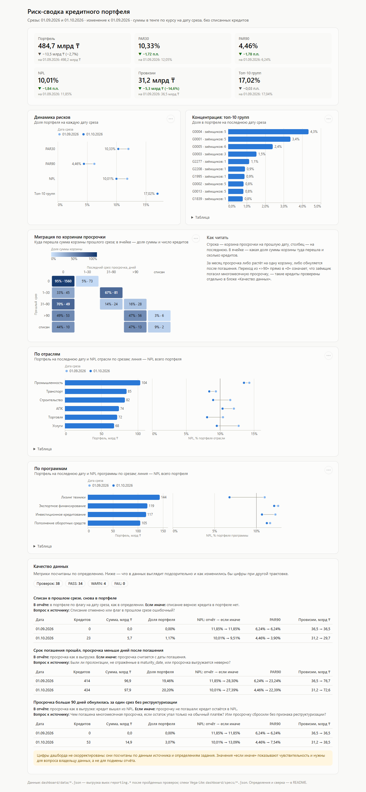

# Риск-сводка кредитного портфеля

Мини-проект на стеке PostgreSQL → семантическая модель в YAML → дашборд на Vega-Lite.
Синтетический портфель, два среза: 01.09.2026 и 01.10.2026.



## Итоговые цифры

| Метрика | 01.09.2026 | 01.10.2026 | Изменение |
|---|---:|---:|---:|
| Портфель | 498,15 млрд ₸ | 484,67 млрд ₸ | −13,48 млрд ₸ (−2,7%) |
| PAR30 | 12,05% | 10,33% | −1,72 п.п. |
| PAR90 | 6,24% | 4,46% | −1,78 п.п. |
| NPL | 11,85% | 10,01% | −1,84 п.п. |
| Провизии | 36,51 млрд ₸ | 31,17 млрд ₸ | −5,34 млрд ₸ (−14,6%) |
| Концентрация: топ-10 групп | 17,04% | 17,02% | −0,03 п.п. |
| Кредитов в портфеле | 1 975 | 1 992 | +17 |

Суммы в тенге по курсу на дату среза (USD: 478,35 на 01.09 и 482,10 на 01.10), без списанных кредитов.
Все цифры совпадают до копейки с независимым пересчётом из CSV на Python.

## Три вывода для риск-комитета

**1. Снижение NPL на 1,84 п.п. не подтверждено данными — без него NPL вырос.**
Всё снижение дали 53 кредита на 14,9 млрд ₸. У них просрочка за один месяц упала с более чем 90 дней
(медиана — 217) до нуля, без реструктуризации. Остаток при этом уменьшился в среднем на 3,9%, как у обычных платящих
кредитов, а не как при погашении многомесячной просрочки. Если погашения не подтвердятся, NPL на 01.10 —
**13,09% (+1,24 п.п. к 01.09)**, PAR90 — 7,54%, провизии — 38,5 млрд ₸ вместо 31,2. Больше всего таких кредитов
в «Лизинге техники» (16 кредитов, 7,0 млрд ₸) — отсюда и его «улучшение» NPL с 11,0% до 6,8%.
*Предложение:* до утверждения отчёта запросить у кредитного подразделения подтверждение погашений по списку
из `reporting.v_data_quality_issues`.

**2. В промышленности ранняя просрочка почти удвоилась — это будущий NPL.**
Промышленность — крупнейшая отрасль (103,6 млрд ₸, 21% портфеля) с самым высоким NPL (13,5%). PAR30 здесь вырос
с 8,5% до 16,5%: 15 кредитов на 10,9 млрд ₸ перешли из просрочки 1–30 в 31–90 дней. По матрице миграции из корзины
31–90 за месяц в «>90» уходит 16% суммы. Если тренд сохранится, через 1–2 среза NPL отрасли заметно вырастет.
*Предложение:* поставить кредиты отрасли с просрочкой 31–90 дней на индивидуальный мониторинг.

**3. Концентрация выше, чем видно по заёмщикам, и в топ-10 есть проблемная группа.**
Десять крупнейших групп связанных заёмщиков держат 17,0% портфеля, а десять крупнейших отдельных заёмщиков — только
10,9%: при подсчёте по заёмщикам риск занижен в полтора раза. Крупнейшая группа G0004 (5 заёмщиков) — 4,3% портфеля.
Группа G0003 (4-е место, 7,4 млрд ₸) на 63% в NPL, G0013 (9-е место) — на 33%.
*Предложение:* проверить лимиты на группы G0003 и G0013 и обеспечение по ним.

Отдельный вопрос к источнику, способный изменить всю картину, — сроки погашения: у 20% портфеля срок уже прошёл,
а просрочки нет (подробнее ниже).

## Как запустить

Нужен только Docker.

```sh
git clone <repo> && cd credit-portfolio-analytics
docker compose run --rm loader              # Postgres, загрузка, витрины, проверки, выгрузка
docker compose run --rm --no-deps verify    # независимый пересчёт на Python и сверка с выгрузкой
docker compose up -d web                    # дашборд: http://localhost:8080
```

`loader` поднимает Postgres 16 и по порядку применяет `sql/*.sql`. Дальше он сверяет число строк с CSV, печатает таблицу
проверок (PASS / WARN / FAIL) и падает на FAIL. Затем прогоняет мутационные тесты проверок, проверяет YAML-модель
против базы и выгружает данные дашборда в `dashboard/data/`. `verify` пересчитывает всё из CSV на Python и сверяет
с этой выгрузкой. Повторный запуск безопасен и даёт те же файлы.

Посмотреть базу: `docker compose exec db psql -U bi -d credit` (порт 5433 снаружи). Убрать всё: `docker compose down -v`.
Дашборд без Docker: `python -m http.server 8080 -d dashboard` — данные уже лежат в репозитории.

## Как проверялись цифры

1. **Сверка с источником в SQL** (`reporting.v_checks`, считается от `raw.*`, а не через витрину):
   - строки: 2030 в raw = 1975 в портфеле + 25 списано + 30 полных дублей (01.09), 2030 = 1992 + 8 + 30 (01.10);
   - суммы в валюте кредита по каждой валюте и дате;
   - портфель в тенге заново как raw × курс на дату.
2. **Независимый пересчёт на Python** (`scripts/verify.py`, только стандартная библиотека): метрики, разрезы,
   матрица миграции и аномалии из CSV, без SQL. Суммы сравниваются точно (Decimal), доли — с допуском 1e-12.
3. **Проверка проверок** (`tests/check_mutations.sql`): в витрину по очереди вносятся 8 типичных ошибок,
   и каждая должна уронить свою проверку. Ошибки такие:
   - дубли не убраны;
   - курс на последнюю дату вместо даты среза (портфель завышен на 648 млн ₸ на 01.09);
   - нет курса на дату;
   - списанные в портфеле;
   - NPL без реструктуризированных;
   - провизии по просрочке без учёта NPL;
   - PAR90 как «90 и больше»;
   - две разные строки кредита на дату.

   Ловятся все. Подмена одной цифры в выгрузке на 1 ₸ роняет `verify.py`.
4. **Граничные случаи** вынесены в проверки с цифрами:
   - 4 кредита с просрочкой ровно 90 дней (01.09) не входят в PAR90 и получают ставку 10%;
   - 2 кредита с ровно 30 днями (01.10) не входят в PAR30;
   - все 93 реструктуризированных кредита в NPL со ставкой 50%, хотя ни у одного просрочка не больше 90 дней.
5. **Согласованность:**
   - сумма по отраслям и по программам равна итогу;
   - топ-10 — ровно 10 групп;
   - в матрице миграции все 2000 кредитов;
   - каждый `column` YAML-модели существует в источнике.

## Данные: что нашли и как решили

Принцип: технические дефекты исправляем и считаем, смысловые данные (флаги, просрочку) в витрине не трогаем.
Метрики считаются по определению, а для каждой аномалии в `reporting.v_data_quality_issues` есть список кредитов,
а в `v_data_quality_summary` — влияние на метрики при другой трактовке и вопрос к владельцу данных.

| Что нашли | Масштаб | Как поступили | Влияние | Вопрос к источнику |
|---|---|---|---|---|
| Полные дубли строк | 30 на каждую дату | Схлопнуты: все поля совпадают | Без этого портфель завышен на 14,3 млрд ₸ (2,9%) на 01.09 и 12,0 млрд ₸ (2,5%) на 01.10 | Почему выгрузка дублирует строки? |
| Просрочка > 90 дней обнулилась за один срез без реструктуризации | 53 кредита, 14,9 млрд ₸ (01.10) | Как в выгрузке | Если не погашали: NPL 10,01% → 13,09%, провизии 31,2 → 38,5 млрд ₸ | Чем погашена просрочка, если остаток упал только на обычный платёж? |
| Списан на 01.09, снова в портфеле на 01.10 | 23 кредита, 5,7 млрд ₸; у 10 из них просрочка 224–395 → 0 дней | В портфеле по флагу на дату — как в определении | Если списание верное: NPL 10,01% → 9,51%, портфель 479,0 млрд ₸ | Списание отменено или флаг на 01.09 ошибочный? |
| Срок погашения прошёл, а просрочка меньше дней после погашения | 434 кредита, 97,9 млрд ₸, 20% портфеля (01.10); до 1656 дней после срока | Как в выгрузке | Если просрочка с даты погашения: PAR90 4,46% → 22,4%, провизии 31,2 → 72,6 млрд ₸ | Были ли пролонгации, не отражённые в `maturity_date`? |

Последняя строка, скорее всего, — особенность синтетических данных. Но в реальном портфеле это был бы первый вопрос
к источнику, поэтому она в реестре, а не в сноске.

Проверены и **не подтвердились**:
- разный регистр валют, пустые значения;
- две разные версии одного кредита на дату;
- заёмщик в нескольких группах;
- смена отрасли, программы или валюты кредита между срезами.

Курс есть на обе даты, подставлять соседний день не пришлось.

## Определения и допущения

- **Портфель** — `principal_outstanding` в тенге по курсу **на дату среза**, без кредитов с `written_off = 1` на эту дату.
  Если курса на дату нет, это FAIL, а не повод взять соседний или последний курс. Последний курс в файле (483,96 на 05.10)
  завысил бы портфель на 648 млн ₸ на 01.09.
- **PAR30 / PAR90** — доля портфеля с просрочкой **строго больше** 30 / 90 дней.
- **NPL** — просрочка больше 90 дней **или** реструктуризация.
- **Провизии** — остаток × ставка: 50% для NPL (в том числе реструктуризированных без просрочки), иначе 10% при 31–90 днях,
  иначе 1%. Шкала — функция `reporting.provision_rate`, одна для витрины и сценариев.
- **Концентрация** — десять крупнейших групп `group_id` на каждую дату. При равных суммах порядок решает `group_id`.
- **Доли** считаются как `сумма числителя / сумма портфеля` на нужном уровне, изменения долей — в п.п.
- Списанный кредит учитывается по флагу на конкретную дату, даже если на прошлую он был списан
  (см. аномалию выше).

## Как устроено

```
CSV ──► raw.* ──► v_loan_snapshot ──► v_portfolio_clean ──► метрики, разрезы, миграция ──► dashboard/data/*.json ──► Vega-Lite
        как есть   дубли, курс,        без списанных,       v_risk_metrics, …               после проверок
                   флаги PAR/NPL       провизии             v_data_quality_*, v_checks
```

| Путь | Что там |
|---|---|
| `sql/0x` | Схемы `raw` и `reporting`, загрузка CSV (`TRUNCATE` + `\copy` в одной транзакции) |
| `sql/1x` | Витрина: `v_loan_snapshot` (кредит × дата, со списанными — для сверки) и `v_portfolio_clean` |
| `sql/2x` | Метрики: `v_group_exposure`, `v_risk_metrics`, `v_risk_metrics_change`, `v_risk_by_segment`, `v_dpd_migration` |
| `sql/3x` | Качество данных: реестр `v_data_quality_issues` и влияние `v_data_quality_summary` |
| `sql/90_v_checks.sql` | Проверки PASS / WARN / FAIL |
| `semantic/portfolio.yml` | Семантическая модель: `model`, `source`, `dimensions`, `measures` |
| `dashboard/specs/*.json` | Спеки Vega-Lite: KPI, динамика, концентрация, миграция, разрезы |
| `dashboard/index.html` | Страница на vega-embed; цвета и светлая/тёмная тема — из CSS-токенов, в спеках цветов нет |
| `scripts/load.sh`, `scripts/verify.py` | Загрузка с проверками и выгрузкой; независимый пересчёт |
| `tests/check_mutations.sql` | Мутационные тесты проверок |

Все вьюхи — `CREATE OR REPLACE VIEW`. Сырые данные не меняются, повторный запуск ничего не ломает.

В YAML-модели только аддитивные меры: суммы в тенге, `count` кредитов и `avg` просрочки с пометкой «без взвешивания».
Доли (PAR, NPL) — это отношения мер. В формате есть только `sum/avg/count`, а `avg` долей по кредитам дал бы
невзвешенное, то есть неверное, число. Поэтому готовые доли лежат в `v_risk_metrics` и `v_risk_by_segment`.

## Работа с ИИ

Проект сделан с Claude Code. Правила, по которым он работал: определения, что нельзя «подгонять», порядок коммитов —
в [CLAUDE.md](CLAUDE.md). Где ИИ ошибся и что исправлено — в [AI_NOTES.md](AI_NOTES.md).
